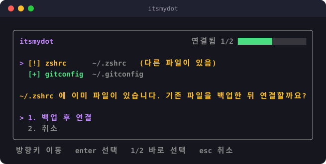
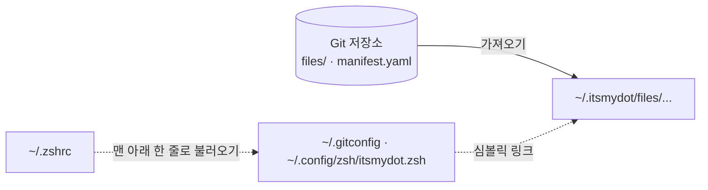

<div align="center">

# itsmydot

**Manage dotfiles, simply.**

[](go.mod)
[](https://github.com/charmbracelet/bubbletea)




</div>

여러 개발 환경에서 dotfile을 일관되게 관리하는 CLI 도구입니다. Git 저장소에서 필요한 설정 파일만 골라 연결하고, 기존 파일은 백업해 필요할 때 복원할 수 있습니다.

## 기능

- 원하는 dotfile만 선택해 연결하거나 해제
- 기존 파일 백업 및 복원
- 저장소에 업데이트가 있는 항목 표시와 최신본 받기
- 로컬 사본과 저장소 최신본의 차이 보기
- 관련 파일을 그룹으로 묶어 접고 펼치기
- 프로필별 Homebrew 패키지의 설치 상태 확인과 골라서 한 번에 설치

## 설치

Go가 필요합니다. macOS에서는 Homebrew로 설치하거나 [go.dev/dl](https://go.dev/dl/)에서 설치 파일을 받을 수 있습니다.

```bash
brew install go
```

Go를 설치한 뒤 itsmydot을 설치합니다.

```bash
go install github.com/4anghyeon/itsmydot/cmd/itsmydot@latest
```

설치 후 `itsmydot` 명령을 찾을 수 없다면 Go의 바이너리 설치 경로가 `PATH`에 포함되어 있는지 확인하세요. 일반적인 기본 경로는 `$(go env GOPATH)/bin`입니다.

## 사용법

```bash
itsmydot
```

실행하면 진입 메뉴에서 `1. dotfiles`와 `2. brewfiles` 중 하나를 고릅니다. 번호를 누르거나 방향키로 옮긴 뒤 <kbd>enter</kbd>를 누르면 그 목록으로 들어갑니다.

dotfiles 목록에서 dotfile을 고르고 <kbd>space</kbd>로 연결하거나 해제합니다.

| 키 | 동작 |
|---|---|
| <kbd>↑</kbd> <kbd>↓</kbd> | 항목 이동 |
| <kbd>←</kbd> <kbd>→</kbd> | 그룹 접기 / 펼치기 |
| <kbd>space</kbd> | 선택한 항목 연결 / 해제 |
| <kbd>enter</kbd> | 항목 메뉴 열기 (최신본 받기, 차이 보기) |
| <kbd>tab</kbd> | 파일 미리보기. 업데이트가 있으면 <kbd>enter</kbd>로 차이 보기 |
| <kbd>?</kbd> | 도움말 |
| <kbd>esc</kbd> | 화면 닫기 / 진입 메뉴로 돌아가기. 진입 메뉴에서는 종료 |

| 표시 | 상태 |
|---|---|
| `[+]` | 연결됨 |
| `[ ]` | 연결되지 않음 |
| `[!]` | 대상 경로에 기존 파일이 있어 충돌함 |
| `[-]` | 작업 실패 |
| `[.]` `[o]` `[O]` | 동기화 진행 중 |
| `^` | 저장소에 업데이트 있음 |
| `v` `>` | 펼친 그룹 / 접힌 그룹 |

brewfiles 목록은 프로필(base, dev, personal)별 Homebrew 패키지와 설치 상태를 보여 줍니다. 설치 상태는 처음 들어갈 때 `brew list`와 `brew tap`으로 확인합니다.

| 키 | 동작 |
|---|---|
| <kbd>↑</kbd> <kbd>↓</kbd> | 항목 이동 |
| <kbd>←</kbd> <kbd>→</kbd> | 프로필 접기 / 펼치기 |
| <kbd>space</kbd> | 설치 안 된 패키지 고르기 / 취소. 프로필 줄에서는 설치 안 된 하위 패키지 전체 |
| <kbd>enter</kbd> | 고른 패키지를 `brew bundle`로 한 번에 설치 |
| <kbd>esc</kbd> | 질문 닫기 / 진입 메뉴로 돌아가기 |

| 표시 | 상태 |
|---|---|
| `[+]` | 설치됨 |
| `[ ]` | 설치 안 됨 |
| `[*]` | 설치하려고 고름 |


## 동작 방식

`manifest.yaml`에 정의된 파일을 저장소에서 `~/.itsmydot/`로 가져온 뒤, `target` 경로에 로컬 사본을 가리키는 심볼릭 링크를 만듭니다.



동기화 방향은 저장소에서 로컬 사본으로 향하는 단방향입니다. 설정을 수정할 때는 저장소의 원본 파일을 편집하세요. 로컬 사본이나 대상 경로에서 한 변경은 저장소에 자동으로 반영되지 않습니다.

## dotfile 추가

`files/` 아래에 파일을 두고 `manifest.yaml`에 항목을 추가합니다.

```yaml
entries:
  - name: gitconfig               # 목록에 보일 이름
    source: files/git/.gitconfig  # 저장소 안의 경로
    target: ~/.gitconfig          # 연결할 위치
    description: git 전역 설정     # 설명 (선택)
```

`loaded_by`를 적으면 그 셸 설정 파일 맨 아래에 `target`을 불러오는 한 줄을 넣고 뺍니다.

```yaml
  - name: zsh
    source: files/zsh/itsmydot.zsh
    target: ~/.config/zsh/itsmydot.zsh
    loaded_by: ~/.zshrc             # 불러오는 줄을 넣을 파일 (선택)
```

## Homebrew 패키지 추가

`files/brew/` 아래의 Brewfile에 `tap`, `brew`, `cask` 줄을 추가합니다. 줄 끝 주석이 목록의 설명이 되고, 없으면 바로 위 `# --- 섹션 ---` 주석을 씁니다.

```ruby
# --- CLI Tools ---
brew "git"   # 버전 관리 시스템
cask "zed"
```

새 프로필을 만들 때는 Brewfile을 추가하고 `manifest.yaml`의 `brewfiles`에 항목을 적습니다.

```yaml
brewfiles:
  - name: dev                          # 목록에 보일 프로필 이름
    source: files/brew/dev.Brewfile    # 저장소 안의 경로
    description: 개발용 CLI 도구와 터미널, 에디터  # 설명 (선택)
```

포크해서 사용할 때는 [`cmd/itsmydot/main.go`](cmd/itsmydot/main.go)의 `repoOwner`, `repoName`을 자신의 저장소에 맞게 바꿉니다.
